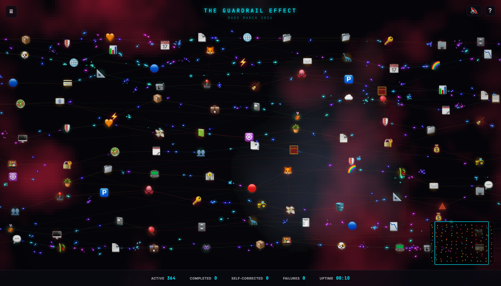

# The Guardrail Effect

**An interactive visualization showing why AI agent guardrails matter.**

Hundreds of particles — each representing an AI agent — flow through a network of 65+ real-world tools (AWS, Stripe, Slack, databases, etc.). As they interact with riskier tools, failures cascade: minor retries, wrong Slack channels, and then the catastrophic stuff — production databases dropped, API keys leaked, customer data exposed.

Toggle guardrails ON, and the chaos stops. Force fields appear around dangerous nodes, particles deflect to safer paths, catastrophic failures drop to zero. The contrast is immediate.



## [Live Demo](https://theguardraileffect.netlify.app/)

## How It Works

Some agents travel alone; others move as small swarms of helper subagents that spread out between tools and converge as they arrive.

Each tool connector has a calibrated risk level and failure probability. Particles traverse the graph, and at each node a probability roll determines the outcome — from self-correcting retries (yellow flash) up to catastrophic explosions with screen shake and alarms.

Guardrails completely block catastrophic events and reduce severe failures by ~95%, with visible green shields and intercept messages like "blocked: requires human approval."

## Tech Stack

- **p5.js** (WebGL) — generative rendering with comet trails, atmospheric effects, cinematic camera
- **Tone.js** — generative audio: data center drone, event-triggered chimes and alarms
- **TypeScript + Vite** — type-safe build with hot reload
- **Vitest + Playwright** — 100+ unit and integration tests (including Monte Carlo failure distributions) plus Playwright E2E
- **lil-gui** — real-time simulation controls
- **Netlify** — deployment

## Architecture

Strict simulation/rendering split — all simulation logic is pure TypeScript with zero browser dependencies, enabling full unit testability:

```
src/simulation/  → pure logic (graph, particles, failures) — tested with Vitest
src/rendering/   → p5.js drawing (nodes, particles, effects) — tested with Playwright
src/sound/       → Tone.js audio engine
src/ui/          → DOM controls and terminal log
```

## Built With AI Agents

The entire project was built using AI coding agents, with me working at the task and direction level rather than writing code directly.

**Claude Code (Opus)** was the primary orchestrator — architecture, simulation engine, task roadmap, testing, and integration. **Gemini** handled parallelizable visual/rendering tasks, dispatched into isolated git worktrees via custom scripts. The multi-agent workflow worked because the architecture enforced clean boundaries between simulation and rendering.

## Getting Started

```bash
git clone https://github.com/puzzler10/the_guardrail_effect.git
cd the_guardrail_effect
npm install
npm run dev
```

```bash
npm run check   # Full suite: vitest + tsc + eslint + vite build
```

## License

MIT

---

*Built by Tom Roth and the Agentic Swarm for the Encode Hackathon, March 2026.*
